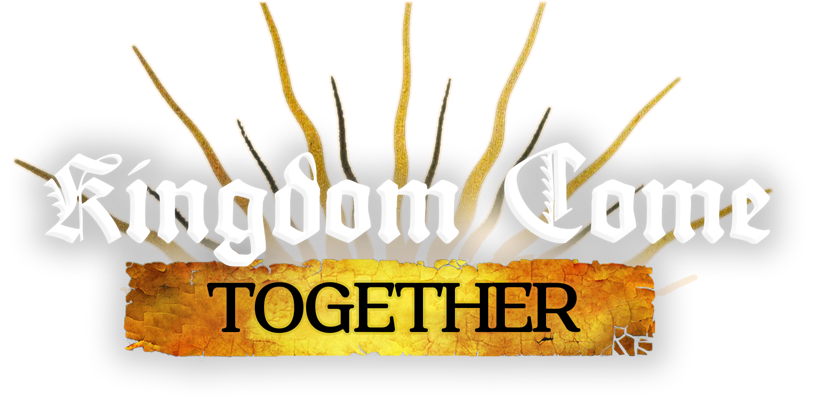

  

  <em>Play Kingdom Come: Deliverance II with a friend. The whole game, in one world.</em> 
  An unofficial, free fan mod. Not affiliated with or endorsed by Warhorse Studios or PLAION.

  
  
  
  
  

  <a href="#install-and-play"><strong>Install</strong></a> ·
  <a href="docs/QUICKSTART.md"><strong>Quick start</strong></a> ·
  <a href="docs/KNOWN-ISSUES.md"><strong>Known issues</strong></a> ·
  <a href="https://dsc.gg/kcd2-together"><strong>Discord</strong></a>

---

## What it is

Kingdom Come: Together is co-op for the single-player game. One of you hosts your world; your friend joins it with
their own Henry. From there you play the game you already know, side by side: the same villages and people, the same
quests, the same fights, the same clock.

It is not a server platform and there are no lobbies of strangers. It is the campaign, shared.

## Where it's at

**Open beta.** You can play for hours and get real quests done together. You will also see things that look wrong,
and now and then something will break. New builds come often.

| Works well | Works, but rough | Not yet |
|---|---|---|
| Joining a friend's world with your own character | Villagers glide a little when they walk on the partner's screen | Cutscenes for both players at once |
| Seeing each other: walking, riding, clothes, weapons | Some villagers stand idle where the host sees them working | Bows and crossbows on the other player's figure |
| Fighting the same enemies; hits and deaths count for both | Trading as the partner can fail to open | Hearing each other's conversations |
| Shared quests: either of you can move a quest forward | Grabs and paired moves in fights don't always show | Playing far apart (you are kept within about 650 m) |
| Talking to the host's villagers | A scripted scene can leave the partner on a black screen for a while | The regular (non-Modding-Tools) game |
| Looting, dropping items for each other, sleeping, one shared clock | Lip sync, voice chat and player-vs-player dice are unpolished | |
| Crime: the host's guards judge both of you | | |

The full, current list lives in **[Known issues](docs/KNOWN-ISSUES.md)**. What changed in each build is on the
**[releases page](https://github.com/DeepFriedDepp/KingdomCome-Together/releases)**.

## What you need

- Windows and Steam
- Kingdom Come: Deliverance II on Steam
- The game's free **Modding Tools** (a separate entry in your Steam library; the launcher installs it for you)
- A friend with the same build of the mod

The mod runs on the Modding Tools version of the game, not the regular one. You start it from the launcher; starting
the game from Steam still gives you normal single-player.

## Install and play

1. Download **`KingdomComeTogether-Setup`** from the [releases page](https://github.com/DeepFriedDepp/KingdomCome-Together/releases/latest) and run it. Both of you.
2. Open the launcher. The first time, it shows a short checklist and sets everything up for you.
3. **Host:** click **HOST GAME**, share the address or Steam code it shows, click **PLAY**, then pick **Start Game** on the game's main menu.
4. **Partner:** click **ADD SERVER** (or **JOIN THROUGH STEAM**), enter what the host gave you, click **PLAY**, then pick **Join Game**.

That's it. The partner needs no save of their own and lands beside the host.

Playing from different houses? Use the Steam code, or see **[Networking](docs/NETWORKING.md)** for the other ways.
Every screen, step by step, is in the **[Quick start](docs/QUICKSTART.md)**.

**Updating:** run the new Setup over the old one. Your settings stay. Both players must be on the same build.

## Good to know

- **Insert** opens the mod menu in the game: every setting in plain words.
- **Period (`.`)** marks the moment something looks wrong, so it is easy to find in a bug report.
- Start past the prologue if you can. **New adventure → Skip the prologue** does this for you.
- No accounts and no telemetry. The mod never changes your Windows security settings.

## Something broke?

Click **REPORT BUG** in the launcher. It gathers the logs into one file with personal details removed. Send that file
on [Discord](https://dsc.gg/kcd2-together) or in a [GitHub issue](https://github.com/DeepFriedDepp/KingdomCome-Together/issues),
and say whether you were hosting or joining and what you were doing.

## More reading

| | |
|---|---|
| [Quick start](docs/QUICKSTART.md) | From nothing to playing together |
| [Known issues](docs/KNOWN-ISSUES.md) | What is not right yet |
| [Networking](docs/NETWORKING.md) | Ways to connect over the internet |
| [The mod menu](docs/MOD-MENU.md) | Every setting explained |
| [Dice between players](docs/DICE.md) | How to play Farkle against your friend |
| [Installing by hand](docs/LAUNCHING.md) | If the installer misbehaves |
| [Building from source](docs/BUILDING.md) | For developers: layout, build, tests |

## Credits and license

Kingdom Come: Together continues [`marczukmichal/kcd2-multiplayer`](https://github.com/marczukmichal/kcd2-multiplayer)
with the original developer's permission. Credit for the original idea and implementation is theirs. See
[AUTHORS](AUTHORS).

Licensed under [GPLv3](LICENSE) with two added terms in [NOTICE](NOTICE): keep the credits, and don't present a
modified version as the official one. This repository is the official one.

Kingdom Come: Deliverance II, its assets and its content belong to Warhorse Studios and PLAION. This project's
copyright covers only its own code.
